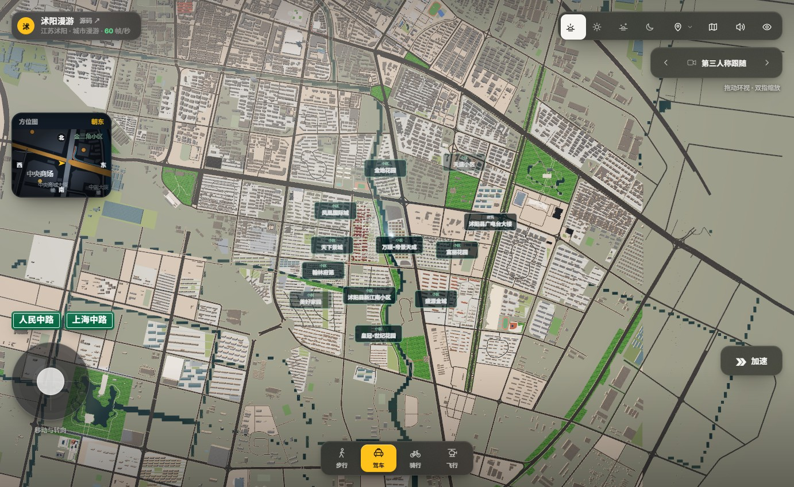

# Slop 沭阳 · 三维城市漫游

在浏览器里步行、驾车、骑行或乘直升机探索江苏沭阳城区。项目基于 **Three.js WebGPU / TSL**，结合开放地理数据、卫星影像判读和可定位实拍，持续补齐建筑、街道、公园与校园。

**[在线体验](https://evangu-cn.github.io/evans-github-pages/slop-shuyang/)** · [还原进度](docs/BUILDING_REFINEMENT_PROGRESS.md) · [逐条核对清单](docs/refinement/README.md) · [验收记录](docs/acceptance/) · [开发约定](AGENTS.md)



*2026-11-15 项目渲染画面。楼体与地表包含来源数据和展示估计，仍在持续还原。*

## 可以体验什么

- **四种出行方式**：步行、驾车、骑行、直升机，支持切换机位和触屏操作。
- **城区导航**：实时小地图、可搜索的全屏街道图、21 处地标传送，以及沿街建筑观察点。
- **城市环境**：昼夜光照、交通、行人、道路曲线、水面、园路与校园细节。
- **可追溯的实景参考**：参考面板区分来源、图片日期、身份确认情况与建模限制。

项目沿用 [Slop New York](https://github.com/mrdoob/slop-newyork/) 的渲染、交通、行人与音频引擎，将城市内容替换为沭阳；城区组织和加载策略也参考了 [Slop 武汉](https://github.com/LightYearZh/slop-wuhan)。保留原项目版权与 MIT 许可证。

## 本地运行

纯静态 ES 模块项目，**没有前端构建步骤，也无需应用后端**。安装 Python 后运行：

```bash
git clone https://github.com/EvanGu-CN/slop-shuyang.git
cd slop-shuyang
python -m http.server 8123
```

打开 [http://127.0.0.1:8123/](http://127.0.0.1:8123/)。使用支持 WebGPU 并启用硬件加速的浏览器，通过 HTTP 访问页面。仅启动静态服务无需安装数据生成依赖。

首次加载会请求 Three.js CDN；实景参考图片和外部地图链接也需要联网。项目内的矢量街道图不请求在线底图瓦片。

可以从这些视角开始：

| 入口参数 | 内容 |
| --- | --- |
| `?tp=central` | 中央商场及人民路核心商圈 |
| `?tp=culture` | 南部文化馆群 |
| `?tp=shiyan` | 沭阳实验小学 |
| `?building=vienna` | 维也纳购物中心沿街观察点 |
| `?debug` | 开发调试入口 |

### 操作

| 按键或界面 | 功能 |
| --- | --- |
| `1` / `2` / `3` / `4` | 步行 / 驾车 / 骑行 / 直升机 |
| `W S A D` | 移动、转向 |
| 按住 `Shift` / 点击“加速” | 临时加速 / 持续加速 |
| `Space` | 跳跃、刹车或上升，随出行方式变化 |
| `M` / 点击小地图 | 全屏街道图与地点搜索 |
| `V` | 切换机位 |
| `H` / `N` / `B` | 隐藏界面 / 静音 / 鸣笛 |

触屏提供移动摇杆与动作按钮。传送菜单中可查看地标、沿街建筑、道路和小区的实景参考。

## 当前范围与还原边界

研究范围东西约 **6.6 公里**、南北约 **7.4 公里**，覆盖人民路、上海路、北京路、苏州路、南湖及政务中心等城区；乡镇与开发区远端不在当前范围内。

截至 2026-11-16，主分支数据如下。建筑统计来自已提交的[数据审计](tools/data/shuyang/building-audit.json)，本次维护没有新增地理数据。

| 项目 | 数量 |
| --- | ---: |
| 建筑来源记录 | 9,977 |
| OSM / Overture 增量 / 影像核对补录 | 1,425 / 6,133 / 2,419 |
| 数据中的地图建筑部件 | 9,982 |
| 道路来源 way / 渲染分段 | 1,104 / 1,105 |
| 地图步道与自行车道 | 92 |
| 可传送地标 | 21 |
| 具名小区近似范围 | 147 |

高度来源分别为：CNBH 估高 **5,264** 条、OSM 高度标签 **1** 条、核对层数 **1** 条、展示估高 **4,711** 条。实拍引导的展示高度独立保留，不覆盖原来源高度。

**当前没有完成全城逐栋现状还原。** 来源记录数、地图部件数和专用模型体块数不能混用；数据量与测试通过也不代表现实城区已经全部收录。部分住宅采用整地块统一层数回填，尚未逐栋核实异形屋顶、立面和门址。照片拍摄日、发表日、获取日及影像采集日分别记录，未知日期保持未知。

### 近期进展

- **商圈与文化馆群**：中央商场主塔及有限入口、蓝天商贸城镂空门架与楼顶、美术馆分散体块、博物馆和图书馆主体与前场；档案馆候选楼体仍标为位置推定。详见[持续还原进度](docs/BUILDING_REFINEMENT_PROGRESS.md)。
- **街道与地面**：连续矢量路缘、台州路局部六车道断面及慢行带、文化片区道路界面、核心商圈沿街铺装；地图、地面和碰撞共用几何。
- **万顺及周边住宅**：万顺地块补 50 栋别墅与 1 栋南侧大棚；周边 0–2.5 公里五环累计补 1,932 栋影像推断建筑，并补内部通道和非建设面。审计口径下空地格与无通道格归零，仍有未调查地块、稀疏院落及建成区外缘。详见[环 4 验收](docs/acceptance/ring4-imagery-2026-11-15/README.md)和[空间与渲染复扫](docs/acceptance/spatial-render-rescan-2026-11-15/README.md)。
- **公园与校园**：保留 OSM 校区边界和实测步道，另按公开资料及影像补虞姬生态园、沭河公园、烈士陵园的部分园路和广场；修正沭河东岸配色、连接路断口及校门铺装遮挡。新增补线为推断，水平误差约 ±6 米。详见[公园补线](docs/acceptance/park-retrofit-2026-11-15/README.md)及[三处修复](docs/acceptance/three-fixes-2026-11-15/README.md)。

## 开发与验证

直接维护 HTML、CSS 和 ES 模块。开始前阅读 [AGENTS.md](AGENTS.md)、相关模块及最近验收记录。

### 环境

| 用途 | 要求 |
| --- | --- |
| 静态预览 | Python HTTP 服务；无需数据工具依赖 |
| Node 测试与地理数据打包 | 本次验证使用 Node.js 24 |
| 地理数据生成与审计 | Python ≥3.12、Shapely 2，依赖见 [requirements-buildings.txt](tools/requirements-buildings.txt) |

数据工具当前锁定的 rasterio 不支持旧版 Python。Windows 推荐使用项目虚拟环境：

```powershell
py -3.12 -m venv .venv
.\.venv\Scripts\python.exe -m pip install -r tools/requirements-buildings.txt
```

### 回归检查

Windows PowerShell：

```powershell
$cases = Get-ChildItem tests -File |
  Where-Object { $_.Name -match '\.test\.(cjs|mjs)$' -and $_.Name -ne 'overpass.test.mjs' } |
  ForEach-Object FullName
node --test $cases
.\.venv\Scripts\python.exe -m unittest discover -s tests -p 'test_*.py'
```

2026-11-16 实测 **430 项 Node、2 项 Python 通过**，见[主分支整合验收](docs/acceptance/branch-integration-2026-11-16/README.md)。另 7 项 Overpass 测试依赖 POSIX 执行环境，未计入上述通过数；具备相应环境时单独运行 `node --test tests/overpass.test.mjs`。

部分测试按源码中的 LF 换行提取函数；Windows 的 `core.autocrlf` 自动转换可能导致定位失败，排查说明见上述验收记录。视觉或几何变更仍需实际浏览器验证，测试不能替代实景身份核对。

### 数据生成

世界坐标以 1 单位 = 1 米，`x` 向东、`z` 向南，原点在人民中路与上海中路交叉口附近。来源、原始属性、判读轨迹和 ID 顺序表保存在 `tools/data/shuyang/`。详见[数据方法与限制](tools/data/shuyang/BUILDINGS.md)。

仅在相应观察记录变动时重跑生成器。已有基础生成链按依赖顺序执行：

```powershell
.\.venv\Scripts\python.exe tools/build-shuyang-online-district.py
.\.venv\Scripts\python.exe tools/build-shuyang-reviewed-district.py
.\.venv\Scripts\python.exe tools/build-shuyang-reviewed-water.py
.\.venv\Scripts\python.exe tools/enrich-shuyang-buildings.py
.\.venv\Scripts\python.exe tools/build-shuyang-urban.py
.\.venv\Scripts\python.exe tools/build-shuyang-landmarks.py
.\.venv\Scripts\python.exe tools/build-shuyang-communities.py
node --max-old-space-size=8192 tools/build-shuyang-geodata.mjs
node tools/audit-photo-refinement.mjs
```

台州路、文化片区、万顺及环状住宅等增量由各自 `tools/build-*.py` 和已提交轨迹维护，运行顺序参照相应验收记录。Node 生成器优先选择项目 `.venv`，也可通过 `SHUYANG_PYTHON` 指定解释器。

新增来源追加到 `building-source-order.json`，保持旧索引稳定。保留来源几何与高度，展示估计另记；GCJ-02 图层先转换为 WGS84。不要手工修改标为 Generated 的输出，包括 `js/shuyang-geodata.js` 和 `js/building-geodata.bin.gz`。

## 目录与文件维护

| 路径 | 内容 |
| --- | --- |
| `index.html`、`css/` | 页面入口、交互与样式 |
| `js/` | 渲染、地图、交通、碰撞、建筑模型及运行数据 |
| `tools/`、`tools/data/shuyang/` | 生成与审计工具、来源数据、观察记录及许可信息 |
| `tests/` | 几何、来源、交互及启动回归 |
| `docs/refinement/` | 持续核对清单 |
| `docs/acceptance/` | 逐批验收报告、审计结果及项目渲染截图 |

来源数据、判读轨迹、生成器和正式验收证据长期保留。`.releases/`（发布包与临时工作树）、`.screenshots/`（截图草稿）、`.trae-html-share-packages/`（分享包）、`.workbuddy/`（研究与浏览器临时目录）和 `__pycache__/` 均被忽略，可在任务结束后清理；清理临时工作树前先用 `git worktree remove` 注销。正式参考原图统一放在被忽略的 `tools/data/shuyang/reference/`，不作为纹理或发布资产。

## 提交与发布

本仓库 [EvanGu-CN/slop-shuyang](https://github.com/EvanGu-CN/slop-shuyang) 维护源码，主分支为 `main`；新开发分支使用 `codex/` 前缀，合并后可删除。`origin` 指向本仓库，原项目保留为 `upstream`，沭阳提交只推送到 `origin`。

在线站点由另一个仓库 [evans-github-pages](https://github.com/EvanGu-CN/evans-github-pages) 的 `main/slop-shuyang/` 目录发布。**推送源码不会自动同步在线体验。**

完成验证并提交、确保工作区干净后打包：

```powershell
.\.venv\Scripts\python.exe tools/package-static-site.py
```

工具只打包已提交的运行文件，输出到 `.releases/`。同步发布时只更新目标仓库的 `slop-shuyang/` 子目录，保留其他游戏与无关文件；核对来源提交、`deployment-manifest.json`、目标测试、Pages 工作流和线上文件校验。

## 许可与署名

代码采用 [MIT License](LICENSE)，保留 Mr.doob 原版权声明。地理数据与参考图片分别遵守各自许可：

- **OpenStreetMap**：© OpenStreetMap contributors，ODbL 1.0。地图、道路、轮廓、水系、POI 和地名保留署名；衍生数据库按相应许可再分发。
- **Overture Buildings 2026-10-21.0**：© Overture Maps Foundation，ODbL 1.0；裁剪记录保留原始来源属性。
- **CNBH-10m**：Wanben Wu，2020 年建筑高度模型，[DOI 10.5281/zenodo.7923866](https://doi.org/10.5281/zenodo.7923866)，CC BY 4.0。本项目进行城区裁剪、像元统计和高度量化。
- **3D-GloBFP**：保留可选匹配支持，未纳入当前发布数据。
- **实拍与研究影像**：版权归原作者或服务提供者；参考面板保留来源和署名。高德、Esri / Vantor 等影像仅用于定位研究，原图不提交、不作为建筑贴图分发。已知 2021 年影像与采集日未知的影像分开标记，服务版本与获取日期不等于拍摄日期。
